# Observability-as-a-Service: Duka on AWS

This capstone is centralized monitoring, logging and automated response for a three-tier application: EC2 web, then ECS Fargate API, then RDS MySQL.

**Scenario.** *Duka* is a Kenyan online shop with three tiers. Apache on two EC2 instances serves the storefront. An order API runs on ECS Fargate. Data lives in RDS for MySQL. The CTO wants to see across all three tiers, catch problems early, and have the platform react on its own when something breaks. This repo builds that layer in CloudFormation, deploys it, runs a mock failure test, and documents what happened.

| | |
|---|---|
| **Report (1–2 pages)** | [REPORT.md](REPORT.md) |
| **Region** | eu-west-1 (Ireland). Cape Town (af-south-1) is the nearest region to Kenya but is opt-in and was not enabled on this account. See the report. |
| **Status** | Deployed, tested and **torn down** after the evidence was captured. Everything here can be redeployed with one script. |

## Architecture

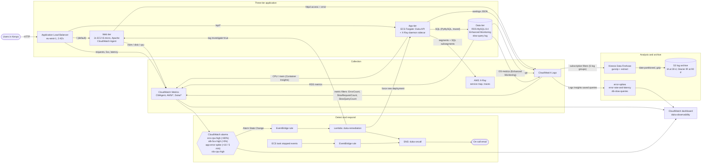

## Evidence

| What | Screenshot |
|---|---|
| Centralized log groups (web, app, DB, Lambda, Firehose, X-Ray) | 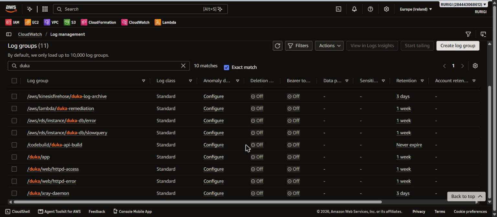 |
| X-Ray trace map: client to API to MySQL | 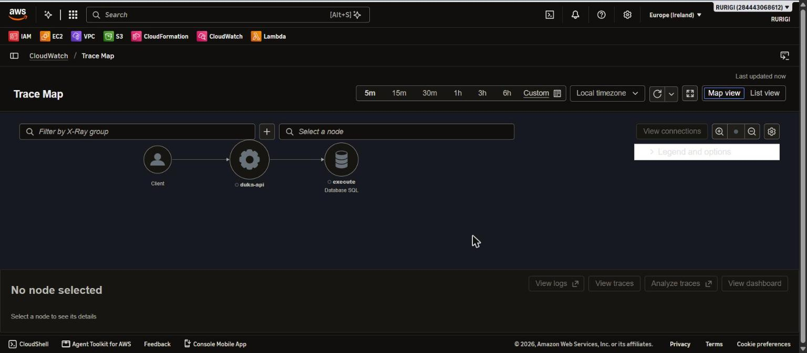 |
| Mock failure test injection | 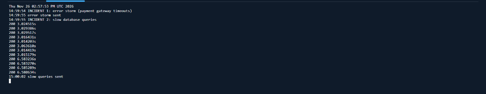 |
| ErrorCount alarm in ALARM 33 s after the error storm | 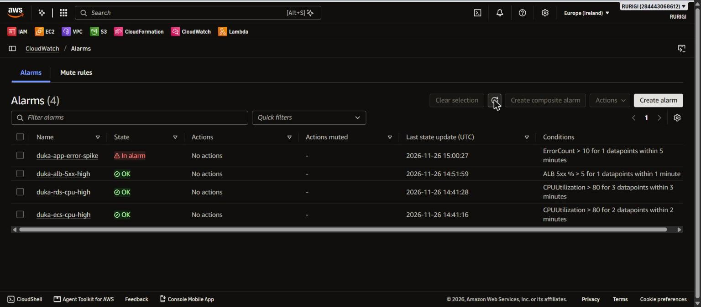 |
| ALB 5xx alarm + ErrorCount alarm in ALARM | 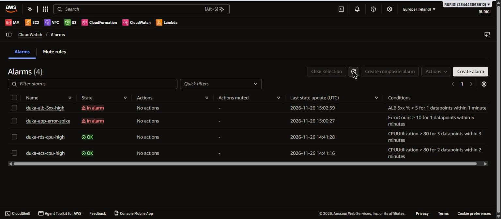 |
| Saved Logs Insights queries | 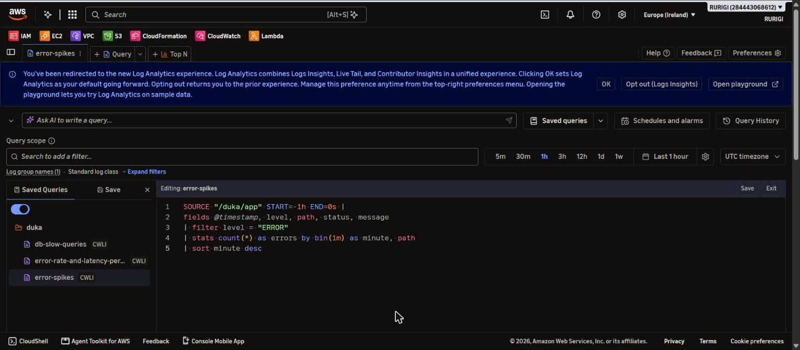 |
| **Remediation Lambda decisions + EC2 `investigate` tags** | 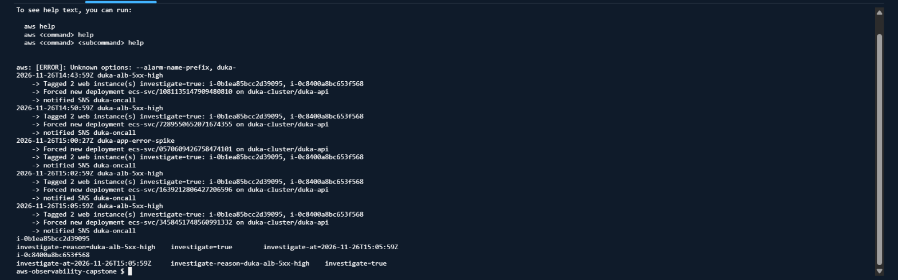 |
| Saved queries' output: error spike, 5xx % per minute, DB slow queries | 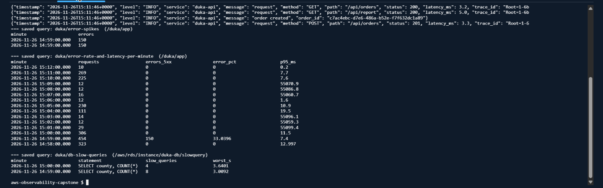 |
| ECS CPU at 100%, Firehose archive in S3 (30 objects, plain JSON lines) | 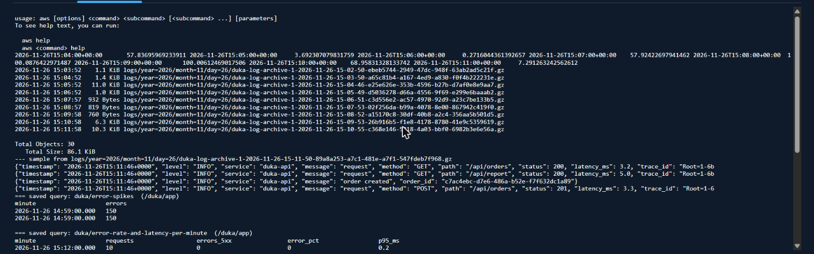 |
| ECS CPU alarm and its automated restart | 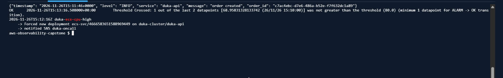 |
| Dashboard: header and alarm overview | 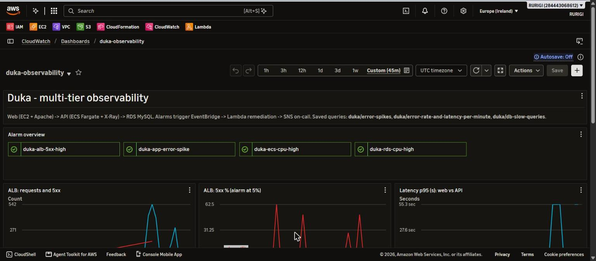 |
| Dashboard: ALB 5xx %, latency, ECS CPU, ErrorCount during the incident window | 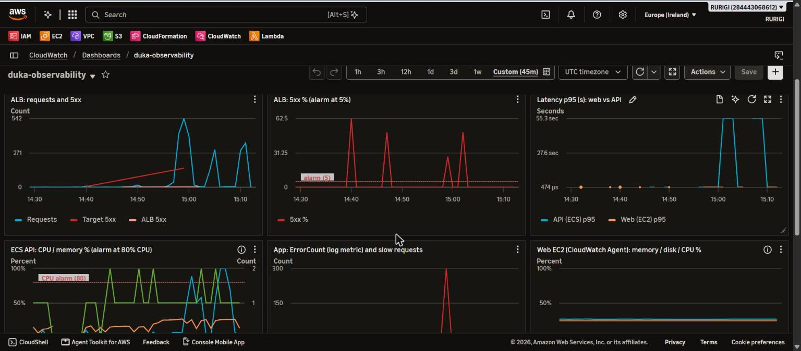 |
| Dashboard: RDS CPU, latency, Logs Insights widget | 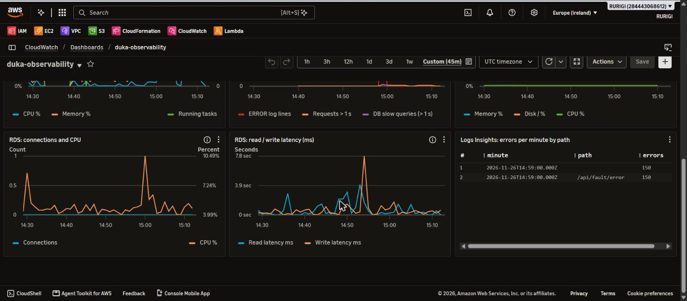 |
| Unplanned real incident caught and auto-remediated | 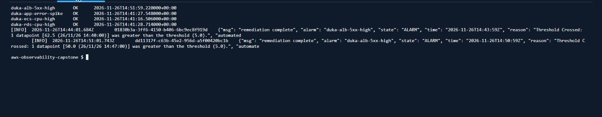 |
| Teardown: all stacks deleted, verify finds nothing left | 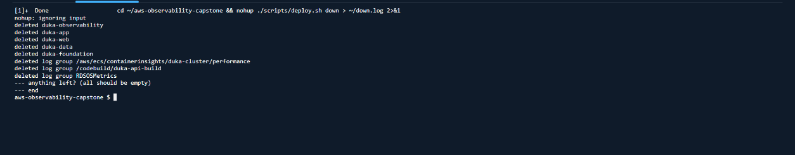 |


## Repository layout

```
app/                         Duka API (Flask). JSON logs, X-Ray (Flask + PyMySQL auto-instrumented), fault-injection endpoints
lambda/remediation/          Remediation Lambda: restart ECS service, tag EC2 investigate=true, page on-call
infrastructure/
  01-foundation.yaml         VPC (2 AZs), security groups, ALB (/ -> EC2, /api/* -> ECS), ECR + CodeBuild image build, S3 log archive
  02-data.yaml               RDS MySQL 8.4, Enhanced Monitoring, error + slow query log export, slow_query_log=1 (long_query_time=1 s)
  03-web.yaml                2x EC2 (Apache) in an ASG, CloudWatch Agent config in SSM (mem, disk, CPU, httpd logs)
  04-app.yaml                ECS Fargate service + X-Ray daemon sidecar, Container Insights, awslogs
  05-observability.tmpl.yaml Firehose -> S3, subscription filters, metric filters, saved queries, alarms,
                             SNS, EventBridge -> Lambda, ECS task-stopped rule, dashboard
scripts/
  render.py                  inlines the Lambda source into 05-observability.yaml
  deploy.sh                  up | base | observability <email> | down | verify
  failure-test.sh            baseline | errors | slow | cpu | all
docs/                        architecture diagram and screenshots
```

## Run it yourself

From AWS CloudShell:

```bash
git clone https://github.com/RURIGIMK/aws-observability-capstone.git && cd aws-observability-capstone
./scripts/deploy.sh up you@example.com    # about 15 min. Confirm the SNS email afterwards
./scripts/failure-test.sh all             # about 10 min of baseline traffic plus 3 injected incidents
./scripts/deploy.sh down                  # deletes every stack, the S3 archive, ECR images and stray log groups, then verifies
```
